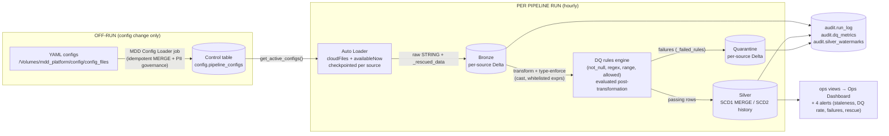

# MDD Platform — Artifact Catalog & Architecture

**Generated:** 2026-11-07 · **Catalog:** `mdd_platform` · **Workspace folder:** `/MDD_DataPlatform`
Everything in this document was verified live against the workspace (notebook cells, job settings, alert definitions, view SQL, table masks/tags) on 2026-11-07 unless noted.

---

## 1. What this platform is

A **metadata-driven (MDD) ingestion platform**: one YAML config per source drives the entire lifecycle — raw bronze landing, typed silver with SCD1/SCD2 merges, data-quality rules with quarantine, PII masking/tagging, audit logging, cost/ops views, dashboards and alerts. **No code changes are needed to add a source** — only a YAML file plus a landing folder. A Declarative Automation Bundle (DAB) exports the whole platform for cross-workspace deployment.

---

## 2. Architecture

### Per pipeline run (hourly orchestration job)

**Key mechanics (all live-proven):**

* **Bronze lands raw STRING** — every declared column plus `_rescued_data` (Auto Loader's per-column drift capture), `_batch_id`, `_file_mtime`, `_ingest_ts`, `_source_file`, `_row_hash`. Data types are enforced from silver up, so schema drift never crashes ingestion.
* **`_row_hash`** is computed at bronze ingest over the configured column set → silver merges detect in-place updates without comparing PII values (which are masked at silver).
* **Silver watermarks** (`audit.silver_watermarks`) + Auto Loader checkpoints make every run incremental and **idempotent** (re-runs process nothing new).
* **Single-pass Stage 3** (2026-11-05 fix): one cached scan per source computes quarantine counts, merge counts, and all DQ pass/fail metrics in one aggregation — O(6) Spark actions per source per run.

### Off-run responsibilities

* **Config loader** — validates transformation expressions (function whitelist), merges YAMLs into the control table (never re-activates a deactivated source), and applies PII governance (see §8).
* **Schema Evolution Runbook** — guarded, idempotent table/config changes.
* **Ops view builders (nightly)** — regenerate the ops views from the control table, so new sources appear automatically.

---

## 3. Jobs

| Job | ID | Schedule / trigger | Runs | Purpose |
| --- | --- | --- | --- | --- |
| MDD Pipeline Orchestration Job | 736782493336258 | Hourly | Metadata-Driven Pipeline Framework notebook (all 8 active sources) | The pipeline itself |
| MDD Config Loader Job | 537108428447391 | Manual (Run Now) · file-arrival trigger on the config volume **configured but currently PAUSED — enabling needs explicit approval** | MDD Config Loader notebook | Config load + PII governance |
| MDD Platform Maintenance Job | 119715286341772 | Daily 02:00 | MDD Platform Maintenance (OPTIMIZE + VACUUM) notebook | Table maintenance (OPTIMIZE + VACUUM) |
| MDD Ops Views Refresh Job | — (see Jobs UI) | Daily 03:00 | Both Ops View Builder notebooks | Nightly regeneration of ops views |
| MDD Schema Evolution Runbook job | — | Manual (Run Now) | Schema Evolution Runbook notebook | Guarded schema changes |
| MDD On-Demand Runbook job | — | Manual (Run Now) | On-Demand Runbook notebook | Single-source load / rebuild |

> Job IDs for the manual runbooks were verified live in the 2026-11-05 audit; schedules verified again on 2026-11-07 for the loader (file-arrival trigger, 60s debounce) and orchestration job.

---

## 4. Notebooks

### 4.1 MDD Metadata-Driven Pipeline Framework — the pipeline

**Notebook ID:** 2856938897732842 · **Widget:** `source_name` (optional single-source mode used by the On-Demand Runbook; empty = all active sources)

| Stage | Cell | What it does |
| --- | --- | --- |
| Architecture Overview | 1 | Header doc: per-run flow vs off-run loader flow, assets, YAML template, add-a-source instructions |
| Stage 1 — Bootstrap | 2 | `CREATE TABLE IF NOT EXISTS` for the 4 framework tables (`pipeline_configs`, `run_log`, `silver_watermarks`, `dq_metrics` — idempotent fresh-environment bootstrap); `source_name` widget; `get_active_configs()` control-table reader (errors on unknown/inactive source in single-source mode). YAML loading deliberately lives in the Config Loader job only. |
| Stage 2 — Bronze ingest | 3 | Per active source: Auto Loader `cloudFiles` + `availableNow`, checkpointed under `/Volumes/mdd_platform/config/checkpoints/<source>`; lands **all columns as raw STRING** plus `_rescued_data`, `_batch_id`, `_file_mtime`, `_ingest_ts`, `_source_file`, `_row_hash`; single-aggregation counts; writes `run_log` bronze rows; quarantines nothing at this layer (drift is rescued, not dropped) |
| Stage 3 — Silver + DQ | 4 | Per source: applies `silver.transformations` (whitelist-validated expressions) and `exclude_columns`; type/length enforcement from config; **DQ rules evaluated post-transformation** (`not_null` / `regex` / `range` / `allowed`); failures → quarantine with `_failed_rules`; passing rows → SCD1 MERGE (upsert on business keys, hash-based) or SCD2 history (close + insert); silver watermark update; **single-pass** DQ metrics (one cached aggregation computes pass/fail for every rule); `run_log` silver rows (read/quarantined/merged) |
| Stage 4 | 5 | Comment: PII governance moved to the Config Loader (keeps the pipeline read-only on governance) |
| Stage 5 — Observability | 6 | Post-run display of counts/metrics for quick eyeballing |

**Live-proven 2026-11-05:** a 3-row test batch produced bronze +3, quarantine +1 (`manager_not_null` only, exact rule attribution), silver update+insert (hash change from the new `department` column), 9 DQ rules with exact pass/fail counts, and the next hourly processed zero new rows (idempotency).

### 4.2 MDD Config Loader — configs + PII governance

**Notebook ID:** 1810228833444908 · **2 cells**

| Cell | What it does |
| --- | --- |
| 1 (md) | Responsibilities + trigger documentation (file-arrival trigger on the config volume, 60s debounce; explicit runs always work) |
| 2 (code) | ① `validate_transformations` — function-whitelist gate (configs stay metadata, never arbitrary SQL) ② `load_configs` — idempotent MERGE into the control table; the `active` flag is **never** re-flipped by a reload ③ PII governance — creates the 4 mask functions, applies **tags + masks** on silver targets (incl. SCD2 history) and quarantine, **tags only** on bronze (raw preserved for pipeline reads); deferred PII (tables/columns not yet created) is caught up on the next loader run |

### 4.3 MDD Schema Evolution Runbook — guarded schema changes

**Notebook ID:** 1969451392395078 · widget-driven, every action idempotent and `dry_run`/`confirm`-gated

| Action | What it does |
| --- | --- |
| `REVIEW` | Drift check: config columns/types vs live tables (uses DESCRIBE — the only reliable type source; `information_schema` reports varchar as string) |
| `ADD` | Add column(s) to config YAML + bronze/quarantine/silver tables, then loader + PII catchup |
| `ALTER_WIDEN` | Safe widen only (e.g. varchar length up) — refuses datatype changes (live-proven: refused + hourly-guard prevented a mid-run race) |
| `RENAME` | Rename column across YAML + all three layer tables |
| `DROP` | Route-only: removes the column from the pipeline route (YAML/transformations) without dropping physical data |
| `ADD_RULES` | Append new DQ rules (`not_null` / `regex` / `range`) — append-only, never silently modifies existing rules |

All actions were proven live on 2026-11-05 (config/loader/job verified via DESCRIBE + YAML + control table, idempotency re-runs = skip).

### 4.4 MDD On-Demand Runbook — manual operations

**Notebook ID:** 1810228833444909

| Mode | What it does |
| --- | --- |
| `load` | Runs the framework for one source only (uses the `source_name` widget) — for immediate reprocessing |
| `rebuild` | Drops silver/quarantine/history/bronze, clears checkpoint + watermark, re-runs the framework once, **then auto-runs the config loader** (2026-11-05 fix: PII masks/tags re-applied after rebuild) |

### 4.5 MDD Ops Costing Views — file-lifecycle cost layer

**Notebook ID:** 2856938897732843 · Creates the 4 costing views over the Ops Dashboard's *File Lifecycle Costing* page

| Cell | What it does |
| --- | --- |
| 2 (md) | Costing/derivation model documentation |
| 3 | `v_storage_footprint` — one row per managed table + landing files |
| 4 | `v_file_lifecycle_cost` — one row per file per microbatch: lifecycle times, rows, bytes, allocated DBU cost. **Fixed 2026-11-07:** orchestration job now **resolved by name** (`WorkspaceClient().jobs.list(name=...)`) — was a stale hardcoded job id (433265226360788) that silently degraded costs to estimates |
| 5 | `v_stage_cost_summary` — per source × stage (bronze/dq/silver) durations + allocated cost |
| 6 | `v_lifecycle_cost_kpis` — per-source + `ALL_SOURCES` KPIs (cost, storage, memory-hours) |
| 7 | Validation cell: counts, reconciliations, spot checks |

> The nightly **Ops Views Refresh Job** regenerates `v_file_lifecycle_cost` from the dedicated builder notebook (§4.7), which uses exact file attribution via `bronze._source_file` — prefer that path for routine regeneration.

### 4.6 / 4.7 MDD Ops View Builders — nightly view regeneration

| Notebook | ID | What it does |
| --- | --- | --- |
| Builder (v_storage_footprint) | 2958611298619986 | Config-driven regeneration of the storage-footprint view: reads active sources + layer targets from the control table, existence guard for not-yet-created tables, auto-detects SCD2 `_history` tables, single landing-root scan, exact bytes from `system.storage.table_metrics_history` with documented estimate fallback |
| Builder (v_file_lifecycle_cost) | 2958611298619985 | Config-driven regeneration of the lifecycle-cost view; exact file→bronze attribution via `_source_file`; correct orchestration job id (736782493336258); **build order: storage builder first** |

### 4.8 MDD Platform Maintenance (OPTIMIZE + VACUUM)

**Notebook ID:** 608890689409315 · Daily 02:00 maintenance job — OPTIMIZE + VACUUM over the managed tables (keeps Delta files compact and storage clean).

### 4.9 – 4.12 Deployment toolchain (DAB)

| Notebook | ID | Purpose |
| --- | --- | --- |
| MDD Deploy Prep (Capture Ops Views + Configs) | 2958611298620000 | Captures ops-view SQL, configs, dashboard/alert sources into the bundle (`databricks.yml` + `resources/`) for export |
| MDD Target Setup | 2958611298619997 | Provisions the target workspace (catalog, schemas, volumes, jobs) — run via `databricks bundle run mdd_target_setup -t prod` |
| MDD Target Smoke Test | 2958611298619999 | Post-deploy verification of the target workspace |
| MDD Target Cleanup | 2958611298619998 | Teardown of a target deployment |

### 4.13 / 4.14 Onboarding test harnesses (historical, kept as reference)

| Notebook | ID | What it proved |
| --- | --- | --- |
| MDD Test src_008 Machine Vibration Onboarding | 1810228833444913 | E2E onboarding incl. SCD2 history + phone-PII masking + transformation-derived column (`phone_digits`) |
| MDD Test src_009 Employee Billing Onboarding | 4502718241427712 | E2E onboarding incl. derived name columns, `manager_not_null` rule, later `department` ADD via Schema Evolution |

---

## 5. Dashboards

| Dashboard | UUID | What it shows |
| --- | --- | --- |
| MDD Platform — Ops Dashboard | 01f1d71fe41516c88fc8b915c99e0e1e | 8 pages / 27 datasets: **Executive Overview** (KPI counters from `v_ops_kpi_summary`: active sources, success rate, rows processed/quarantined/rescued, failing rules, PII gaps, late sources), **Pipeline Runs & Reliability** (`v_pipeline_runs`, `v_run_health`, `mv_pipeline_kpis` metric view), **Data Quality & Quarantine** (failing rules by source, rule pass/fail), **Schema Drift & Rescue** (rescued values by drift column), **PII & Governance**, **Performance, SLA & Cost**, **Global Filters**, **File Lifecycle Costing** (the 4 costing views) |
| Workspace Usage Dashboard | 01f1d71fd7981247b408499ddc5bd84f | Workspace billing analysis over `system.billing.usage`: spend by period/product/SKU, tag-matching %, top spending — supports the cost governance story |

---

## 6. Alerts (all verified 2026-11-07; warehouse b868acb7b7a9f713, timezone Asia/Calcutta)

| Alert | ID | Condition (query → threshold) | Schedule | State |
| --- | --- | --- | --- | --- |
| MDD Watermark Staleness | 1810228833444922 | Active sources whose silver watermark is older than 2 hours > 0 | Hourly at :15 | **TRIGGERED** — expected: no new source files have landed since the 2026-11-05 proof run; fires by design when data stops arriving. Pause it until go-live, or accept the signal. |
| MDD DQ Quarantine Rate Breach | 1810228833444921 | Max per-source silver quarantine rate (last 24h) > 5% | Every 15 min | OK |
| MDD Pipeline Run Failures | 1810228833444924 | Failed runs in `audit.run_log` (last 24h) > 0 | Every 15 min | OK |
| MDD Bronze Rescue Warnings | 1810228833444923 | Bronze-layer runs with an error message (last 24h) > 0 | Hourly at :10 | OK |

---

## 7. Data assets

| Asset | What it is |
| --- | --- |
| `mdd_platform.config.pipeline_configs` | **Control table** — one row per source: full YAML config, business keys, PII columns, quality rules, file path, active flag. The `active` flag is the on/off switch for the pipeline; reloads never re-activate a deactivated source. |
| `mdd_platform.bronze.<source>` ×8 | Raw STRING landing tables (one per active source) |
| `mdd_platform.silver.<source>` ×8 | Typed, merged current-state tables (SCD1 upserts or SCD2 history-backed) |
| `mdd_platform.silver.<source>_history` | SCD2 physical history (where configured) |
| `mdd_platform.quarantine.<source>` ×8 | Failed-DQ rows with `_failed_rules` (exact rule attribution) |
| `mdd_platform.audit.*` | `run_log` (per run per layer: rows read/written/rescued/quarantined/merged, status, error, timing), `dq_metrics` (per rule per run pass/fail), `silver_watermarks` (incremental position) |
| `mdd_platform.ops.v_*` + `mv_pipeline_kpis` | Ops/analytics views (run health, KPIs, freshness/SLA, rescued data, 4 costing views, metric view). Union views are generated from the control table — re-run the builders after onboarding |
| Volumes | `config/config_files` (YAMLs), `config/checkpoints` (Auto Loader state), `config/docs`, `landing/source_files/<source>` (incoming files) |

**8 active sources** (verified count, 2026-11-07): src_001…src_009 incl. SCD2 (src_008) and transformation/exclusion cases (src_008, src_009).

---

## 8. How PII masking works *(the boss answer)*

**One sentence:** PII is never altered in storage — instead, Unity Catalog **column masks** are attached to the silver/quarantine/history tables so that *any* query of those columns returns a redacted value at read time, while bronze keeps raw values (tags only) so the pipeline can keep processing.

### The mask functions (created by the Config Loader in `mdd_platform.config`)

| Function | Rule | Example |
| --- | --- | --- |
| `mask_email` | keep first 2 chars of local part + `***@` + domain | `john.doe@corp.com` → `jo***@corp.com` |
| `mask_phone` | `***-***-` + last 4 digits (non-digits stripped) | `+91 98765 43210` → `***-***-3210` |
| `mask_name` | first character + `***` | `Emily` → `E***` |
| `mask_full` | `***MASKED***` (street address, financial) | `12 Oak St` → `***MASKED***` |

All functions preserve NULL (a missing value stays missing, not a fake mask).

### Which function is used — from the YAML

Each source's `pii_columns` maps column → PII type: `email`, `phone`, `name`, `street_address`, `financial`. The loader maps type → function (`email→mask_email`, `phone→mask_phone`, `name→mask_name`, `street_address/financial→mask_full`).

### Where masks and tags are attached (live inventory, 2026-11-07)

| Table | Masked columns | Notes |
| --- | --- | --- |
| silver.src_001_customers | first_name, last_name, email, phone, address | + PII column tags |
| silver.src_004_employees | full_name, email, phone, salary | salary = financial → mask_full |
| silver.src_008_machine_vibration (+ _history) | employee_phone, supplier_contact, phone_digits | phone_digits is a *transformation-derived* column — silver-only |
| silver.src_009_employee_billing | first_name, last_name | derived from full_name (which is excluded from silver) |
| silver.src_003_payments | card_last4 | already-tokenized source column |
| quarantine.* | same as silver for non-derived columns | quarantined rows carry the same PII |
| bronze.* (all sources) | **no masks — tags only** | raw preserved for pipeline reads |

### The four rules that make this safe

1. **Masks are read-time.** `ALTER TABLE … ALTER COLUMN … SET MASK` attaches metadata; writes are unaffected (the pipeline writes raw into silver; every *read* of the column gets the redacted value). The functions here are unconditional — no exempt list — so **every reader** (dashboards, SQL, notebooks) sees masked values in silver/quarantine/history.
2. **Bronze stays raw, governed by tags.** The pipeline reads bronze to build silver; if bronze were masked, silver would be filled with masked garbage. Bronze PII columns instead carry governance tags (`pii_type`, `sensitivity=high`, plus the governed `pii` tag where the policy allows it) — Bronze access should therefore be restricted to pipeline/ops roles.
3. **The pipeline never needs unmasked reads.** Change detection uses `_row_hash` computed at bronze ingest; silver merges compare hashes and business keys, never PII values. Quarantine writes happen before the read-time mask matters. Result: masking cannot break the pipeline.
4. **SCD2 history is masked too** — the loader masks the physical `_history` table (and the current-state table under SCD1), so old versions of a record are equally redacted.

### Governance extras

* **Governed tag policy:** the Unity Catalog `pii` tag key only allows values `email`/`phone`, so the loader applies the governed `pii` tag only to those PII types; every PII column also gets `pii_type` + `sensitivity=high` tags (visible in Catalog Explorer and usable by ABAC policies).
* **Deferred PII catchup:** when a new source's tables don't exist yet, the loader defers its masks/tags and prints the deferred list — the next loader run after the source's first pipeline run catches up automatically (this is why the On-Demand Runbook's rebuild re-runs the loader).

---

## 9. Platform invariants (for anyone extending it)

* Bronze = raw STRING + rescued data; types enforced from silver up.
* Configs are the only place schemas/rules/PII are defined; the control table is the runtime source of truth.
* Reloads never flip `active`; new YAMLs start active.
* Transformation expressions are whitelist-validated; DQ rules are evaluated **post-transformation** and can reference config + derived columns.
* All runbooks idempotent + `dry_run`/`confirm` gated; schema changes go through the Schema Evolution Runbook only.
* Ops union views are control-table driven — rebuild after onboarding.

---

## 10. Current state & next steps

* **Go-live ready** — full governance + redundancy audit passed 2026-11-05, single-pass framework fixes live-proven, all notebooks verified clean.
* **Pending approval:** enabling the Config Loader's file-arrival trigger (currently PAUSED; a YAML write in the config volume will then auto-fire one idempotent loader run).
* **Watermark Staleness alert is TRIGGERED** — by design (no new files since the Nov-5 proof). Pause it until production cutover, or treat as signal.
* **Multi-client ready (2026-11-07):** the bundle takes a **`catalog_name` variable** (default `mdd_platform`). Deploy to a client with `databricks bundle deploy -t prod --var="catalog_name=<client>"`. How it flows: the 4 alerts' queries use `${var.catalog_name}` natively (deploy-time substitution); the Target Setup job receives the variable as a task parameter and (1) creates the catalog/schemas/volumes under that name, (2) rewrites the catalog into every YAML config before loading it into the client's config volume, (3) applies the captured ops/metric views with **job-ID + catalog** substitution, and (4) patches **every deployed notebook and the Ops Dashboard file** the same way. Target-side copies therefore differ from the repo by design (same as the pre-existing job-ID patching). The Ops Dashboard may need a re-open/re-publish in the target after patching — the smoke test validates its dataset SQL.
* **Bundle gap fixed:** the MDD Schema Evolution Runbook job/notebook was missing from the bundle and is now included (manual Run Now job, widget-driven).
* **Next phase:** Git + DAB + CI/CD — the bundle at `/MDD_DataPlatform` (databricks.yml + resources/) is the deployment unit; refresh bundle contents from Deploy Prep before export (it still holds 7 YAMLs vs the 8 live sources). `bundle validate` runs from an exported local checkout (`workspace export-dir` produces the `../<notebook>.py` sources the job tasks reference).
